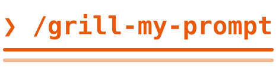

<p>
  
</p>

# Grill My Prompt

[](LICENSE)

Uma skill para o Claude Code que entrevista você sobre o seu prompt, tapa os buracos e entrega um `.md` pronto para usar em outra sessão.

Você escreve uma frase. A outra sessão recebe a explicação que um colega de trabalho precisaria: o contexto do projeto, as decisões tomadas, o que fica de fora e como saber que terminou.

## Índice

- [O problema](#o-problema)
- [A solução](#a-solução)
- [Como funciona](#como-funciona)
- [Instalação](#instalação)
- [Uso](#uso)
- [Exemplo](#exemplo)
- [O que tem dentro](#o-que-tem-dentro)
- [Créditos](#créditos)
- [Licença](#licença)

## O problema

Um prompt curto deixa decisões em aberto, e quem executa preenche essas lacunas por conta própria. "Adiciona dark mode no meu app" não diz se existe um botão de tema, quais telas entram, nem o que conta como pronto. O prompt também pode citar algo que nem existe no projeto.

Pedir apenas "melhora esse prompt" costuma não resolver: o Claude reescreve o texto e escolhe por você. Nos testes feitos para criar esta skill, foi o que aconteceu: as decisões vinham prontas, e nenhum `.md` era gerado.

## A solução

| Problema | Como a skill resolve |
|---|---|
| O prompt cita algo que não existe | Compara cada premissa com o projeto antes de perguntar |
| Decisões tomadas em silêncio | Entrevista em rodadas, com uma recomendação em cada pergunta |
| Perguntas que o código já responde | Descobre os fatos sozinha e pergunta só o que é decisão sua |
| Ferramentas úteis que ficam esquecidas | Levanta skills, plugins, conectores e apps da sua máquina e busca skills externas |
| "Pronto" vago | Exige um critério verificável por comando ou observação |
| Prompt gerado sem você revisar | Envia um relatório e só gera o arquivo depois da sua aprovação |
| A outra sessão não viu esta conversa | Escreve um `.md` que se entende sozinho, como uma explicação a um colega |

## Como funciona

Quando você roda o comando, a skill não executa o seu prompt: trata o texto como o objeto da avaliação. A tarefa em si fica para a outra sessão.

1. **Investiga o projeto.** Lê o que o prompt toca e marca o que é verdade e o que não existe.
2. **Levanta as ferramentas.** Verifica skills, plugins, conectores e apps instalados, consulta o [`find-skills` no repositório da Vercel](https://github.com/vercel-labs/skills/blob/main/skills/find-skills/SKILL.md) e aplica os passos dele ao seu prompt para buscar skills externas. Ela só indica; instalar o que for indicado é decisão sua.
3. **Entrevista você.** Cada rodada traz todas as decisões que já podem ser tomadas, cada uma com a recomendação dela. Um "sim" aceita a recomendação.
4. **Pede validação.** Envia um relatório com o que encontrou, as decisões, as premissas, o escopo, o critério de pronto e as ferramentas. Nada é gerado antes da sua aprovação.
5. **Gera o prompt.** Grava `prompts/AAAA-MM-DD-<slug>.md` no diretório atual.
6. **Entrega.** Mostra o caminho e a frase para colar na nova sessão.

Pressa no prompt não pula a entrevista. Se você pedir expressamente para não ser perguntado, as decisões em aberto viram premissas, e o relatório continua sendo enviado para validação.

## Instalação

Escolha uma das formas. O comando muda conforme a instalação, e usar as duas deixa a skill duplicada.

<details open>
<summary><strong>Marketplace do Claude Code</strong>: comando <code>/grill-my-prompt:grill-my-prompt</code></summary>

```bash
claude plugin marketplace add SecurityMass/grill-my-prompt
```

```bash
claude plugin install grill-my-prompt@grill-my-prompt
```

</details>

<details>
<summary><strong>CLI de skills</strong>: comando <code>/grill-my-prompt</code></summary>

Precisa de Node.js. Para todos os projetos:

```bash
npx skills add SecurityMass/grill-my-prompt --skill grill-my-prompt -g -a claude-code
```

Só no projeto atual:

```bash
npx skills add SecurityMass/grill-my-prompt --skill grill-my-prompt -a claude-code
```

</details>

<details>
<summary><strong>Manual</strong>: comando <code>/grill-my-prompt</code></summary>

Copie a pasta [`skills/grill-my-prompt`](skills/grill-my-prompt) para `~/.claude/skills/`.

</details>

Não é preciso instalar mais nada: a skill consulta o `find-skills` direto no repositório da Vercel.

## Uso

```
/grill-my-prompt <seu prompt>
```

Instalada pelo marketplace, use `/grill-my-prompt:grill-my-prompt <seu prompt>`. A skill só roda quando você chama o comando, então não interrompe seus outros pedidos. Ela responde no idioma em que você fala.

## Exemplo

```
/grill-my-prompt adiciona dark mode no meu app, rápido que o cliente tá esperando
```

A primeira rodada, resumida, parte do que a skill encontrou no projeto:

> **O que achei:** o README diz que os clientes usam `/pedidos`, mas essa rota não existe. O Tailwind também não parece estar ligado.
>
> ❓ **P1 - Código e `/pedidos`**: Esta pasta é o app completo, e onde está a `/pedidos`? Se ela estiver em outro repositório, o cliente não verá nenhuma mudança.
>
> ➡️ Recomendo tratar esta pasta como incompleta e começar só com esse código em mãos.
>
> ❓ **P2 - Como o tema é ativado**: Segue o sistema do usuário ou tem um botão? O botão exige salvar a preferência e evitar o flash de tema claro ao carregar.
>
> ➡️ Recomendo seguir o sistema, que é o caminho mais rápido.

Depois da sua aprovação, o arquivo gerado tem estas seções:

```
prompts/2026-11-02-dark-mode.md
├── O que precisa ser feito e por quê
├── Contexto do projeto
├── O que fazer
├── Decisões já tomadas
├── Premissas não confirmadas
├── Fora de escopo
├── Ferramentas
├── Pronto quando
└── Ao terminar
```

Na nova sessão, basta colar:

```
Leia prompts/2026-11-02-dark-mode.md e execute a tarefa.
```

## O que tem dentro

```
skills/grill-my-prompt/SKILL.md   a skill
.claude-plugin/                   manifests do plugin e do marketplace
assets/                           banner deste README
```

## Créditos

- [`grilling`](https://github.com/mattpocock/skills/tree/main/skills/productivity/grilling), de Matt Pocock: rodadas de perguntas com recomendação, e a separação entre fatos e decisões.
- [`handoff`](https://github.com/mattpocock/skills/tree/main/skills/productivity/handoff), de Matt Pocock: indicar skills no documento final e remover dados sensíveis.
- [andrej-karpathy-skills](https://github.com/multica-ai/andrej-karpathy-skills): não escolher em silêncio, propor a alternativa mais simples e exigir critério verificável.
- [Superpowers](https://github.com/obra/superpowers), de Jesse Vincent: aprovação antes de avançar, revisão final do texto e testes de skill com subagentes.
- [`find-skills`](https://github.com/vercel-labs/skills), da Vercel: busca de skills externas.

## Licença

[MIT](LICENSE)
